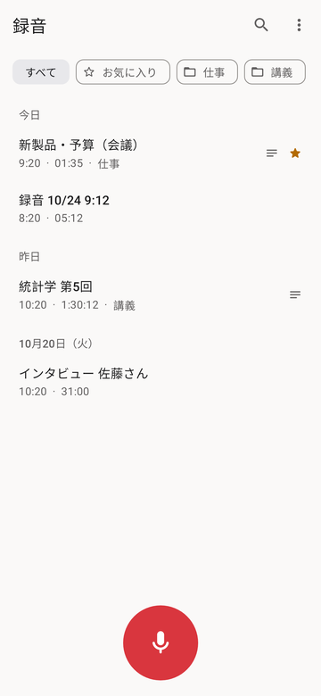
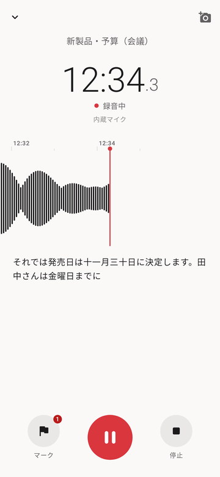

# Open Recorder

[](https://github.com/nekochan-cute/OpenRecorder/actions/workflows/android.yml)

Android voice recorder with on-device transcription, speaker labels, summaries and translation.
AI services (OpenRouter, Google AI Studio, OpenAI, Groq, OpenAI-compatible APIs) are optional.

<p>




</p>

## Features

| Area | |
| --- | --- |
| Recording | Pause and resume, screen-off recording, AAC (M4A), MP3 or WAV, 16 or 48 kHz, mono or stereo, built-in / wired / USB / Bluetooth mics, directional capture where supported, recording modes (including automatic), crash recovery |
| Playback | Waveform with marks, drag to scrub, ±10 s, 0.5×–3× speed, silence skipping |
| Marks | Notes and photos at a moment, tap to jump |
| Editing | Keep or remove a range, or join recordings; originals are kept |
| Library | Folders, favourites, search, trash, import |
| Transcription | Live captions and saved audio with [sherpa-onnx](https://github.com/k2-fsa/sherpa-onnx) (ReazonSpeech, Haas, SenseVoice; captions and saved audio can use different models) or an AI service; editable, tap to play |
| Speakers | Speaker labels on the device, live and refined after recording; rename and fix |
| Summary | On-device LLM ([LiteRT-LM](https://github.com/google-ai-edge/LiteRT-LM): Gemma 4 E2B, TinySwallow 1.5B), extractive summary or an AI service; meeting, lecture and interview templates; brief, standard or detailed; shown as Markdown |
| Translation | Seven languages with the on-device LLM or an AI service; timestamps and speakers are kept |
| Audio clean-up | Noise reduction, voice enhancement and loudness levelling, saved as a new recording |
| Sharing | M4A, MP3 or WAV, transcript and translation, SRT or WebVTT, Markdown summary, marks |

## Privacy

Data stays in app storage and out of cloud backup. Nothing is sent unless you choose an AI service; API keys are
encrypted with the Android Keystore.

## On-device models

Downloaded under **Settings → Models**; interrupted downloads resume.

| Purpose | Model | Size |
| --- | --- | --- |
| Transcription (ja) | ReazonSpeech v2, int8 | 160 MB |
| Transcription (ja, meetings and lectures) | ReazonSpeech v2, fp32 | 614 MB |
| Transcription (ja, after recording) | Haas-ja v1.0, int8/4-bit | 480 MB |
| Transcription (ja/en/zh/ko/yue) | SenseVoice Small, int8; language detected or fixed | 239 MB |
| Speech detection | Silero VAD | 2 MB |
| Speakers | 3D-Speaker CAM++ | 28 MB |
| Summary and translation | Gemma 4 E2B, TinySwallow 1.5B or your own `.litertlm` | 2.6 GB / 1.6 GB |

The LLM needs arm64-v8a or x86_64. Model licences: [THIRD_PARTY_NOTICES.md](THIRD_PARTY_NOTICES.md).

## AI services

**Settings → AI services** picks a service for summaries and one for transcription. OpenRouter signs in through
the browser; the others take an API key.

## Download

Each successful [CI run](https://github.com/nekochan-cute/OpenRecorder/actions/workflows/android.yml) has the APKs as plain `.apk` downloads. Most phones need
`OpenRecorder-arm64-v8a-debug.apk`.

## Building

JDK 17, Android SDK platform 35 and build tools 35.0.0. The first build downloads the sherpa-onnx AAR from
its GitHub releases and checks its SHA-256 (`app/build.gradle.kts`). Android 10 or later.

```sh
./gradlew :app:assembleDebug :app:testDebugUnitTest :app:lintDebug
./gradlew :app:connectedDebugAndroidTest
./gradlew :app:testDebugUnitTest --tests '*ScreenshotTest*' -Pscreenshots  # render screens to build/screenshots
```

## License

[Apache License 2.0](LICENSE). Third-party components: [THIRD_PARTY_NOTICES.md](THIRD_PARTY_NOTICES.md).
