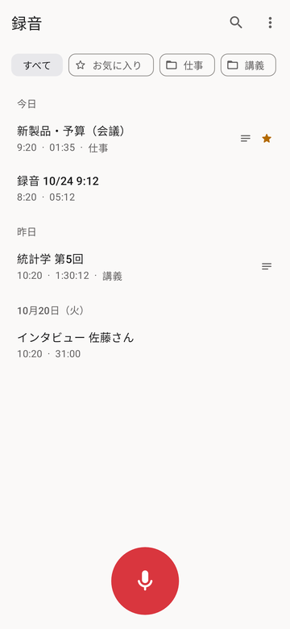
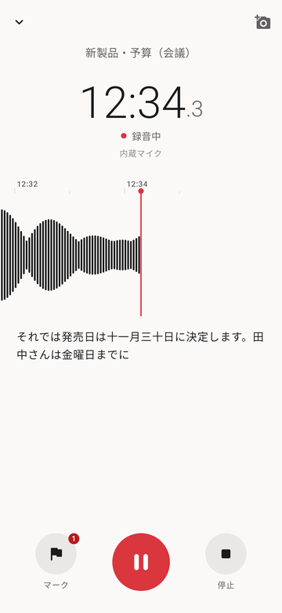
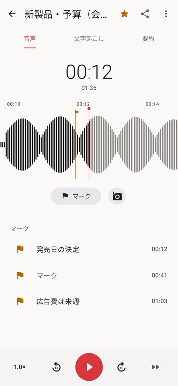
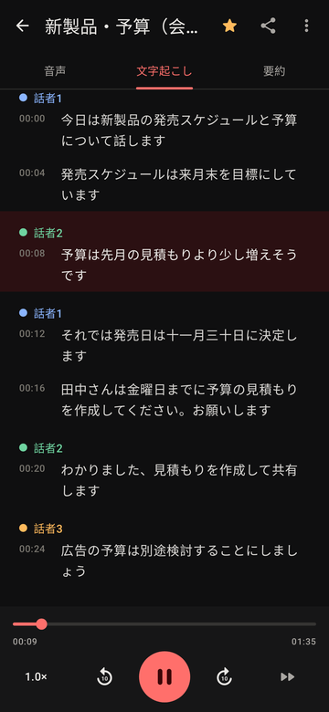

# Open Recorder

[](https://github.com/nekochan-cute/OpenRecorder/actions/workflows/android.yml)

A voice recorder for Android that transcribes, separates speakers, summarizes and translates on the device.
AI services are optional: connect OpenRouter, Google AI Studio, OpenAI, Groq or any OpenAI-compatible API when you want them.

<p>




</p>

## Features

| Area | |
| --- | --- |
| Recording | One tap to record, pause and resume, keeps recording with the screen off; AAC (M4A), MP3 or WAV; 16 or 48 kHz, mono or stereo; built-in / wired / USB / Bluetooth microphones; directional capture (front or towards you, with adjustable width) on phones that support it; crash-safe writing with recovery |
| Playback | Scrolling waveform with marks, drag to scrub, ±10 s, 0.5×–3× speed, silence skipping |
| Marks | Flag a moment while recording or playing, add a note or a photo, tap to jump |
| Editing | Keep or remove a selected range, or join several recordings into one; the originals are kept |
| Library | Folders, favourites, search across titles, transcripts, marks and summaries, trash, import of any format the phone can decode |
| Transcription | Live captions while recording and transcription of saved audio on the device with [sherpa-onnx](https://github.com/k2-fsa/sherpa-onnx) (ReazonSpeech for Japanese, SenseVoice for Japanese/English/Chinese/Korean) or with an AI service; edit text, tap a sentence to play from there |
| Speakers | Speaker separation on the device, live while recording and refined over the whole recording afterwards; rename speakers, fix a sentence's speaker |
| Summary | Generative summary with an on-device LLM ([LiteRT-LM](https://github.com/google-ai-edge/LiteRT-LM): Gemma 4 E2B or TinySwallow 1.5B), extractive summary, or an AI service; automatic title; templates for meetings (decisions, action items), lectures and interviews |
| Translation | Translate the transcript into seven languages with the on-device LLM or an AI service; timestamps and speakers are kept, and translated captions can be shared |
| Audio clean-up | Noise reduction, voice enhancement and loudness levelling, saved as a new recording |
| Sharing | Audio as M4A, MP3 or WAV, transcript and translation, SRT or WebVTT captions, summary as Markdown, list of marks |

## Privacy

Recordings, photos and transcripts stay in app storage and are excluded from cloud backup. Nothing is sent
anywhere unless you choose an AI service; API keys are encrypted with the Android Keystore. No ads or analytics.

## On-device models

Models are not bundled; download them under **Settings → Models** (downloads resume if interrupted).

| Purpose | Model | Size |
| --- | --- | --- |
| Transcription (Japanese) | ReazonSpeech v2, int8 | 160 MB |
| Transcription (ja/en/zh/ko/yue) | SenseVoice Small, int8 | 239 MB |
| Speech detection (required) | Silero VAD | 2 MB |
| Speakers | 3D-Speaker CAM++ | 28 MB |
| Summary and translation | Gemma 4 E2B / TinySwallow 1.5B, or your own `.litertlm` | 2.6 GB / 1.6 GB |

The LLM runs on arm64-v8a and x86_64 devices. Licences of each model are listed in
[THIRD_PARTY_NOTICES.md](THIRD_PARTY_NOTICES.md).

## AI services

**Settings → AI services** picks a service for summaries and one for transcription. OpenRouter supports
signing in through the browser (OAuth PKCE); other services take an API key, with a button that opens the
provider's key page. Models are listed from the service. Details: [docs/API_CONTRACT.md](docs/API_CONTRACT.md).

## Download

Each successful [CI run](https://github.com/nekochan-cute/OpenRecorder/actions/workflows/android.yml) lists the APKs
under Artifacts; each one downloads as a plain `.apk` file. Most phones need `OpenRecorder-arm64-v8a-debug.apk`.

## Building

JDK 17 and the Android SDK (platform 35, build tools 35.0.0). The first build downloads the sherpa-onnx AAR
from Hugging Face and checks it against a pinned SHA-256 (`app/build.gradle.kts`).

```sh
./gradlew :app:assembleDebug :app:testDebugUnitTest :app:lintDebug
./gradlew :app:connectedDebugAndroidTest                                   # device or emulator
./gradlew :app:testDebugUnitTest --tests '*ScreenshotTest*' -Pscreenshots  # render screens to build/screenshots
```

Android 10 (API 29) or later.

## Documentation

Japanese: [specification](docs/SPECIFICATION.md), [API contract](docs/API_CONTRACT.md),
[testing and device checklist](docs/VALIDATION.md), [CI](docs/CI.md).

## License

[Apache License 2.0](LICENSE). Third-party components: [THIRD_PARTY_NOTICES.md](THIRD_PARTY_NOTICES.md).
