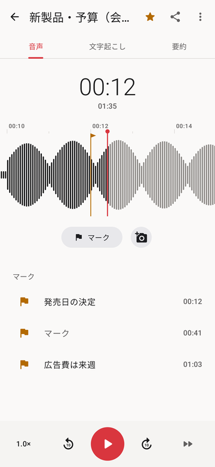
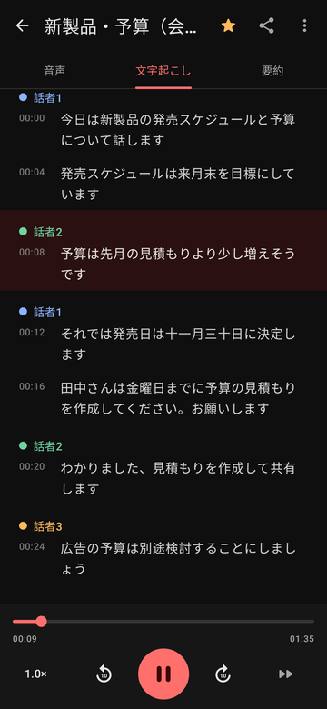

# Open Recorder

[](https://github.com/nekochan-cute/OpenRecorder/actions/workflows/android.yml)

Android voice recorder with on-device transcription, speaker labels and summaries.
AI services (OpenRouter, Google AI Studio, OpenAI, Groq, OpenAI-compatible APIs) are optional.

<p>




</p>

## Features

| Area | |
| --- | --- |
| Recording | Pause and resume, screen-off recording, 16 or 48 kHz, mono or stereo, built-in / wired / USB / Bluetooth mics, crash recovery |
| Playback | Waveform with marks, drag to scrub, ±10 s, 0.5×–3× speed, silence skipping |
| Marks | Notes and photos at a moment, tap to jump |
| Editing | Keep or remove a range, saved as a new recording |
| Library | Folders, favourites, search, trash, import |
| Transcription | Live captions and saved audio with [Vosk](https://alphacephei.com/vosk/) or an AI service; editable, tap to play |
| Speakers | Speaker labels with the Vosk speaker model; rename and fix |
| Summary | Extractive summary or an AI service; meeting, lecture and interview templates |
| Audio clean-up | Noise reduction, voice enhancement and loudness levelling, saved as a new recording |
| Sharing | M4A or WAV, transcript, SRT or WebVTT, Markdown summary, marks |

## Privacy

Data stays in app storage and out of cloud backup. Nothing is sent unless you choose an AI service; API keys are
encrypted with the Android Keystore.

## Speech models

Add a ZIP from the [Vosk model list](https://alphacephei.com/vosk/models) under **Settings → Add model**,
e.g. `vosk-model-small-ja-0.22` (speech) or `vosk-model-spk-0.4` (speakers).

## AI services

**Settings → AI services** picks a service for summaries and one for transcription. OpenRouter signs in through
the browser; the others take an API key.

## Download

APKs are in the `debug-apks` artifact of each successful [CI run](https://github.com/nekochan-cute/OpenRecorder/actions/workflows/android.yml). Most phones need `arm64-v8a`.

## Building

JDK 17, Android SDK platform 35 and build tools 35.0.0. Android 10 or later.

```sh
./gradlew :app:assembleDebug :app:testDebugUnitTest :app:lintDebug
./gradlew :app:connectedDebugAndroidTest
./gradlew :app:testDebugUnitTest --tests '*ScreenshotTest*' -Pscreenshots  # render screens to build/screenshots
```

## License

[Apache License 2.0](LICENSE). Third-party components: [THIRD_PARTY_NOTICES.md](THIRD_PARTY_NOTICES.md).
